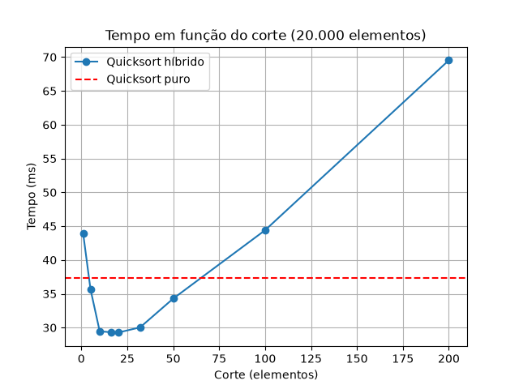

# Relatório: Quicksort híbrido com inserção

## Ambiente

- Processador: Intel Core i5-4460S @ 2.90 GHz
- RAM: 8 GB
- Windows, 64 bits
- Python 3, com `matplotlib`

## Como foi feito

- Quicksort com pivô aleatório (`random.choice`), separando a lista em menores, iguais e maiores que o pivô.
- Versão híbrida: quando o pedaço tem menos que `corte` elementos, chama a ordenação por inserção.
- Lista de 20.000 números aleatórios entre 0 e 1.000.000. A mesma lista foi usada em todos os testes.
- Cada configuração foi executada 20 vezes e o tempo da tabela é a média.
- Depois de cada execução o resultado é comparado com `sorted()` para conferir se ordenou certo.

## Resultados

Quicksort puro: **37,31 ms**

| corte | tempo (ms) | ganho sobre a pura |
|------:|-----------:|-------------------:|
| 1     | 43,91      | -17,7%             |
| 5     | 35,66      | +4,4%              |
| 10    | 29,46      | +21,0%             |
| 16    | 29,32      | +21,4%             |
| 20    | 29,26      | +21,6%             |
| 32    | 30,04      | +19,5%             |
| 50    | 34,29      | +8,1%              |
| 100   | 44,40      | -19,0%             |
| 200   | 69,53      | -86,3%             |

## Gráfico

A linha tracejada vermelha é o tempo da quicksort pura.

## Análise

### Melhor corte

O melhor tempo foi com **corte = 20**: 29,26 ms contra 37,31 ms da rápida pura, um ganho de cerca de 22%.
Os cortes 10, 16 e 32 ficaram muito próximos (diferença de menos de 1 ms), então a faixa boa fica mais ou menos entre 10 e 32 elementos.

O ganho acontece porque, em pedaços pequenos, a quicksort gasta muito tempo criando listas novas e fazendo chamadas recursivas para separar poucos elementos. A inserção resolve esses pedaços direto, sem essas chamadas extras.

### Cortes grandes demais

A partir de 50 o ganho começa a cair, e com 100 e 200 o híbrido fica mais lento que a rápida pura (com 200 levou quase o dobro do tempo). No gráfico dá para ver a curva subindo quase em linha reta depois do ponto mínimo.

Isso acontece porque a inserção é O(n²). Com pedaços pequenos isso não pesa, mas com pedaços de 100 ou 200 elementos a quantidade de comparações e deslocamentos cresce rápido e passa a custar mais do que a quicksort economizou.

### Corte = 1

Com corte = 1 a condição `len(lista) < corte` só é verdadeira para listas vazias, que já estão ordenadas. Ou seja, a inserção nunca faz trabalho de verdade e o algoritmo faz exatamente as mesmas divisões da rápida pura. No comportamento, as duas são o mesmo algoritmo.

O tempo, porém, ficou 17,7% maior (43,91 ms contra 37,31 ms). Essa diferença não vem da ordenação em si, e sim do custo extra de cada chamada da versão híbrida:

- ela recebe um parâmetro a mais (`corte`) em todas as chamadas recursivas;
- faz um teste a mais (`len(lista) < corte`) em cada chamada;
- sempre que um dos lados fica vazio, chama a função de inserção, que não tem nada para fazer.

Como a quicksort faz dezenas de milhares de chamadas para ordenar 20.000 elementos, esse custo pequeno por chamada acaba aparecendo no total. Em Python chamar função é relativamente caro, por isso o efeito é visível.
